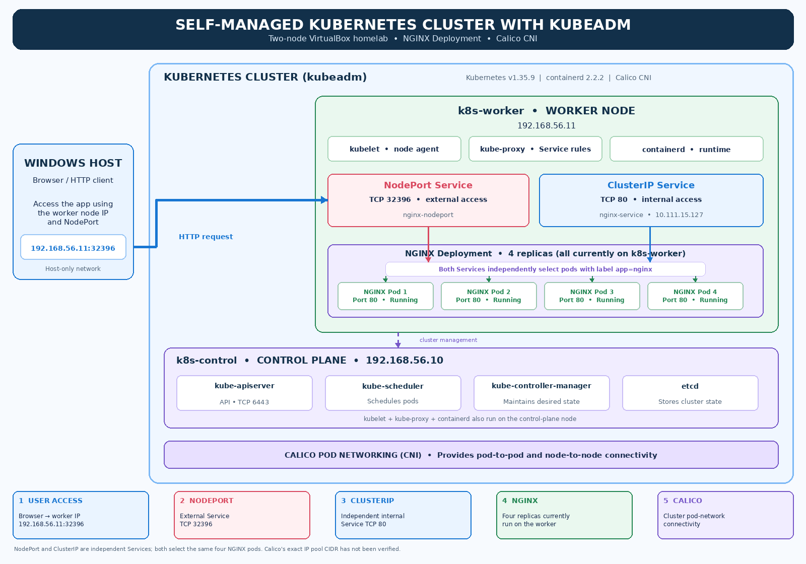
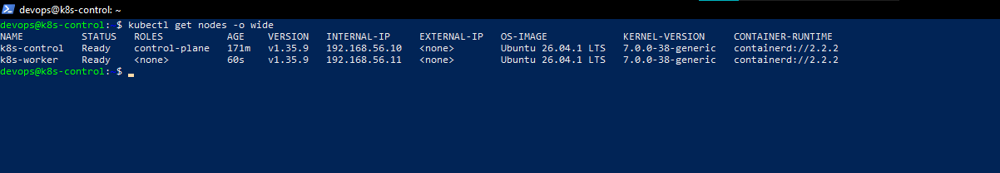
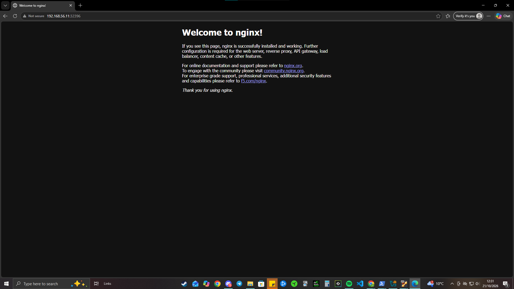

# Self-Managed Kubernetes Cluster | kubeadm Homelab

**A two-node Kubernetes cluster built and operated from scratch on Ubuntu virtual machines — without a managed Kubernetes service.**

This project demonstrates hands-on cluster administration, container networking, application deployment, service exposure, workload recovery, scaling, rolling updates, and troubleshooting.

**Key result:** A working Kubernetes v1.35.9 control plane and worker node running an NGINX application with **4 replicas**, accessible from the Windows host through a **NodePort Service**.

The repository includes Kubernetes manifests and **19 architecture, configuration, operation, and troubleshooting screenshots**.

[View the Architecture](#architecture) · [Implementation Evidence](#implementation-evidence) · [Deployment Guide](#deploy-the-application) · [Troubleshooting](#troubleshooting-and-lessons-learned)

---

## At a Glance

| Area | Implementation |
| --- | --- |
| Infrastructure | 2 Ubuntu 26.04.1 LTS VMs on Oracle VirtualBox, with NAT and host-only networking |
| Kubernetes | v1.35.9, bootstrapped with `kubeadm` |
| Container runtime | containerd 2.2.2 |
| Pod networking | Calico v3.31.0 |
| Workload | NGINX Deployment, 4 replicas on the worker node |
| Services | ClusterIP for internal access; NodePort for access from the Windows host |
| Reliability features tested | Readiness/liveness probes, pod self-healing, scaling, rolling updates, rollback |
| Configuration | Declarative Kubernetes YAML manifests stored in Git |

---

## Architecture



### Cluster Nodes

| VM | Responsibility | Host-only IP |
| --- | --- | --- |
| `k8s-control` | Kubernetes control plane | `192.168.56.10` |
| `k8s-worker` | Kubernetes worker running NGINX pods | `192.168.56.11` |

### How Traffic Reaches the Application

**External lab access:**

Windows host → Worker node `192.168.56.11:32396` → `nginx-nodeport` Service → NGINX pods.

**Internal cluster access:**

In-cluster clients → `nginx-service` ClusterIP Service (port 80) → NGINX pods.

**Cluster management:**

`kubectl` communicates with the Kubernetes API server on the control plane. Kubernetes schedules and manages application workloads on the worker node.

The ClusterIP and NodePort Services are **separate ways to reach the same workload**. Traffic does not need to pass through one Service to reach the other.

The IP addresses and NodePort are specific to this local lab.

---

## VM Network Configuration

Each virtual machine uses a VirtualBox networking arrangement designed for a local Kubernetes environment.

- **NAT:** Provides outbound connectivity for downloading packages and installing software.
- **Host-only networking:** Enables communication between the Windows host and Kubernetes virtual machines.
- **Static IP addresses:** Provide predictable addresses for cluster administration, SSH and application access.

### Infrastructure Evidence

| Configuration | Screenshot | Purpose |
| --- | --- | --- |
| NAT adapter | [View configuration](screenshots/03-control-plane-nat.png) | Outbound network access |
| Host-only adapter | [View configuration](screenshots/04-control-plane-hostonly.png) | Communication between the Windows host and lab VMs |
| Static control-plane IP | [View configuration](screenshots/06-control-plane-static-ip.png) | Predictable control-plane address at `192.168.56.10` |

These screenshots document the control-plane VM configuration.

The worker node was assigned `192.168.56.11` on the host-only network.

---

## What I Implemented

### 1. Infrastructure Preparation

- Created Ubuntu virtual machines using Oracle VirtualBox.
- Configured NAT and host-only networking.
- Assigned predictable node IP addresses.
- Installed and configured containerd.
- Installed Kubernetes components.
- Initialised the control plane using `kubeadm`.
- Joined a worker node to the cluster.

### 2. Kubernetes Networking

- Installed Calico as the Container Network Interface (CNI).
- Verified Kubernetes system components.
- Confirmed both cluster nodes reached the `Ready` state.
- Tested communication through Kubernetes Services.

### 3. Application Deployment

- Created a declarative NGINX Deployment.
- Configured CPU and memory requests and limits.
- Configured readiness and liveness probes.
- Created ClusterIP and NodePort Services.
- Verified NGINX was running on the worker node.

### 4. Application Connectivity

- Tested internal access through the ClusterIP Service.
- Exposed NGINX through a NodePort Service.
- Accessed the application from the Windows host.
- Verified HTTP connectivity after application updates.

### 5. Kubernetes Operations

- Scaled the Deployment to four replicas.
- Deleted a pod to observe automatic replacement.
- Performed a rolling application update.
- Verified the application after updating.
- Rolled back the Deployment to a previous revision.

### 6. Infrastructure Troubleshooting

- Investigated Kubernetes bootstrap issues.
- Diagnosed VirtualBox CPU performance problems.
- Investigated cluster access and RBAC issues.
- Recovered the cluster and verified its components.

---

## Implementation Evidence

The following screenshots document the working Kubernetes environment and the operational tests completed during the project.

Supporting installation evidence is included as links to keep the README easy to navigate.

### 1. Kubernetes Cluster Running

Both the control-plane and worker nodes successfully joined the cluster and reached the `Ready` state.



**Additional evidence:**

- [Container runtime configured](screenshots/16-control-plane-containerd.png)
- [Kubernetes tooling installed](screenshots/22-kubernetes-tools-installed.png)
- [Calico CNI installed](screenshots/42-calico-cni-installation.png)
- [Kubernetes system pods running](screenshots/43-kubernetes-system-pods-running.png)

### 2. Application Deployment and Networking

NGINX was deployed on the Kubernetes worker node and exposed using Kubernetes Services.

The application was accessible from the Windows host through the NodePort Service.



**Additional evidence:**

- [NGINX workloads scheduled on the worker](screenshots/51-nginx-workloads-on-worker.png)
- [ClusterIP internal connectivity](screenshots/52-nginx-clusterip-service-connectivity.png)

### 3. Kubernetes Operations and Recovery

The cluster was used to practise common Kubernetes administration tasks.

| Capability | Evidence |
| --- | --- |
| Pod self-healing | [Replacement pod after deletion](screenshots/54-kubernetes-self-healing-replacement-pod.png) |
| Manual horizontal scaling | [Four NGINX replicas](screenshots/55-nginx-horizontal-scaling-four-replicas.png) |
| Rolling update | [Successful rollout](screenshots/56-nginx-rolling-update-success.png) |
| Post-update validation | [Application connectivity after update](screenshots/57-nginx-post-update-connectivity.png) |
| Rollback | [Application connectivity after rollback](screenshots/58-nginx-rollback-connectivity.png) |

These tests demonstrate how Kubernetes maintains the desired number of application replicas and supports controlled application changes.

### 4. Troubleshooting Evidence

The Kubernetes lab required diagnosing issues beyond the application manifests.

**Kubernetes access and RBAC recovery**

[View RBAC recovery screenshot](screenshots/28-kubernetes-rbac-recovery.png)

**VirtualBox hardware acceleration and performance**

[View native VT-x acceleration confirmation](screenshots/37-native-vtx-acceleration-confirmed.png)

---

## Design Decisions

| Decision | Reason |
| --- | --- |
| Use `kubeadm` instead of a managed Kubernetes service | Gain direct experience with cluster bootstrap, node management, networking and troubleshooting |
| Use separate control-plane and worker VMs | Understand Kubernetes node roles and workload scheduling |
| Use NAT and host-only networking | Provide outbound package access while keeping lab networking local |
| Use predictable node addresses | Simplify SSH, cluster communication and NodePort testing |
| Use containerd | Provide a container runtime for Kubernetes workloads |
| Use Calico | Enable pod networking within the self-managed cluster |
| Use declarative YAML manifests | Keep application configuration version-controlled and repeatable |
| Use ClusterIP and NodePort | Demonstrate internal service networking and application access from outside the cluster |
| Configure readiness and liveness probes | Practise Kubernetes workload health management |
| Configure resource requests and limits | Practise basic CPU and memory resource management |

---

## Repository Structure

```text
kubeadm-kubernetes-lab/
├── README.md
├── manifests/
│   ├── deployment.yaml
│   ├── service-clusterip.yaml
│   └── service-nodeport.yaml
└── screenshots/
    ├── 03-control-plane-nat.png
    ├── 04-control-plane-hostonly.png
    ├── 06-control-plane-static-ip.png
    ├── 16-control-plane-containerd.png
    ├── 22-kubernetes-tools-installed.png
    ├── 28-kubernetes-rbac-recovery.png
    ├── 37-native-vtx-acceleration-confirmed.png
    ├── 42-calico-cni-installation.png
    ├── 43-kubernetes-system-pods-running.png
    ├── 49-two-node-kubernetes-cluster-ready.png
    ├── 51-nginx-workloads-on-worker.png
    ├── 52-nginx-clusterip-service-connectivity.png
    ├── 53-nginx-nodeport-browser-access.png
    ├── 54-kubernetes-self-healing-replacement-pod.png
    ├── 55-nginx-horizontal-scaling-four-replicas.png
    ├── 56-nginx-rolling-update-success.png
    ├── 57-nginx-post-update-connectivity.png
    ├── 58-nginx-rollback-connectivity.png
    └── 59-kubeadm-kubernetes-architecture.png
```

---

## Deploy the Application

### Prerequisites

An existing, functioning Kubernetes cluster with:

- `kubectl` installed and configured.
- Kubernetes nodes in the `Ready` state.
- A working container runtime and CNI.

**Important:** These manifests deploy the NGINX application and Services. They do not provision the underlying VMs or create the Kubernetes cluster.

### 1. Clone the Repository

```bash
git clone https://github.com/ismaaeelahmed11/kubeadm-kubernetes-lab.git
cd kubeadm-kubernetes-lab
```

### 2. Validate the Manifests

```bash
kubectl apply --dry-run=client -f manifests/
```

### 3. Deploy the Application

```bash
kubectl apply -f manifests/
```

### 4. Verify the Cluster and Workloads

```bash
kubectl get nodes -o wide
kubectl get deployments
kubectl get pods -o wide
kubectl get services
```

### 5. Check Deployment Status

```bash
kubectl rollout status deployment/nginx-demo
```

### 6. Access NGINX

From the Windows host connected to the VirtualBox host-only network:

```text
http://192.168.56.11:32396
```

The address and port are environment-specific. Check `kubectl get services` if your setup differs.

---

## Operational Tests

The following operations were performed against the lab environment.

### Horizontal Scaling

Scale the NGINX Deployment to four replicas:

```bash
kubectl scale deployment nginx-demo --replicas=4
```

Verify the running pods:

```bash
kubectl get pods -o wide
```

**Result:** Four NGINX replicas were running on the Kubernetes worker node.

### Pod Self-Healing

Kubernetes Deployments maintain the desired number of application replicas.

During testing, an NGINX pod was deleted and the associated ReplicaSet created a replacement pod.

Monitor the application pods:

```bash
kubectl get pods -l app=nginx-demo -w
```

**Result:** Kubernetes automatically replaced the deleted pod to restore the desired replica count.

### Rolling Updates

A rolling update was performed by changing the NGINX container image version.

Monitor rollout progress:

```bash
kubectl rollout status deployment/nginx-demo
```

Inspect rollout history:

```bash
kubectl rollout history deployment/nginx-demo
```

**Result:** The Deployment completed its rollout and application connectivity was verified afterwards.

### Deployment Rollback

A previous Deployment revision was restored using:

```bash
kubectl rollout undo deployment/nginx-demo
```

Verify completion:

```bash
kubectl rollout status deployment/nginx-demo
```

**Result:** The rollback completed and NGINX connectivity was successfully tested.

> These are operational exercises performed against the lab. Imperative changes should be reflected in declarative manifests when those changes are intended to remain part of the desired configuration.

---

## Troubleshooting and Lessons Learned

### 1. VirtualBox Performance and Kubernetes Bootstrap

**Challenge:**

During Kubernetes setup, the control-plane VM encountered CPU lockups and stalled Kubernetes components.

**Investigation:**

- Checked the virtual machine's performance and resource configuration.
- Investigated host virtualization settings.
- Examined Kubernetes component behaviour during bootstrap.
- Verified native hardware acceleration was available.

**Resolution:**

Recovered the VM environment with native hardware virtualization available and restored normal Kubernetes operation.

**Evidence:** [VirtualBox hardware acceleration verification](screenshots/37-native-vtx-acceleration-confirmed.png)

**Lesson learned:**

Kubernetes stability depends on the underlying infrastructure. VM performance, CPU virtualization and host configuration can affect control-plane availability.

### 2. Kubernetes Bootstrap and RBAC

**Challenge:**

During the initial setup and recovery process, Kubernetes API access and permissions required investigation.

**Investigation:**

- Examined cluster administration access.
- Investigated Kubernetes RBAC configuration.
- Worked through cluster recovery and component verification.

**Resolution:**

Recovered administrative access and continued the Kubernetes setup.

**Evidence:** [Kubernetes RBAC recovery](screenshots/28-kubernetes-rbac-recovery.png)

**Lesson learned:**

Understanding Kubernetes authentication, authorization and control-plane access is important when diagnosing cluster administration problems.

### 3. Understanding Workload Scheduling

**Observation:**

The four NGINX replicas were scheduled on the worker node.

**Lesson learned:**

Multiple pod replicas improve resilience against individual pod failures, but they do not protect against a complete worker-node failure when every replica runs on the same node.

### 4. Kubernetes Service Networking

**Observation:**

The same NGINX workload was exposed through both ClusterIP and NodePort Services.

**Lesson learned:**

ClusterIP provides internal Kubernetes service connectivity, while NodePort exposes a Service through a node's network address and allocated port.

---

## Scope and Limitations

This project is a **local Kubernetes homelab**, not a production deployment.

- The cluster contains one control-plane node and one worker node.
- The control plane is not highly available.
- All four NGINX replicas run on a single worker node.
- A worker-node failure can make the application unavailable.
- NodePort access is through the configured VirtualBox host-only network, not the public internet.
- Infrastructure provisioning and kubeadm bootstrap are not automated in this repository.
- Scaling was performed manually; a Horizontal Pod Autoscaler was not implemented.

These limitations are intentional within the scope of the lab.

---

## Project Outcome

Successfully built and operated a **two-node, self-managed Kubernetes cluster** using `kubeadm`, containerd and Calico on Ubuntu virtual machines.

The project provided practical experience in:

- Kubernetes control-plane and worker-node administration.
- Container runtime and CNI configuration.
- Declarative application deployment.
- Kubernetes Service networking.
- Application health checks and resource management.
- Manual workload scaling.
- Pod self-healing and Deployment reconciliation.
- Rolling updates and rollbacks.
- Infrastructure and Kubernetes troubleshooting.

**The objective was to gain hands-on experience with the underlying Kubernetes infrastructure and day-two operations, complementing experience with managed Kubernetes platforms such as Amazon EKS.**
