# Self-Managed Kubernetes — Production-Grade Practices | kubeadm, Linux & Cluster Operations

**Kubernetes · Linux (Ubuntu) · kubeadm · containerd · Calico · VirtualBox · Networking · YAML · Troubleshooting**

> **Completed Kubernetes Infrastructure & Platform Engineering Project**  
> Built and operated a **self-managed, two-node Kubernetes cluster** using Ubuntu virtual machines, kubeadm, containerd and Calico. Demonstrated cluster bootstrapping, Linux networking, **four NGINX replicas**, Service connectivity, Pod self-healing, horizontal scaling, rolling updates and rollback, supported by **19 implementation screenshots** and a technical walkthrough.

**Quick access:** [Video walkthrough (2:00)](https://youtu.be/a9hATioCGcs) · [Architecture](#architecture--cluster-design) · [Deployment proof](#deployment-proof--four-key-screenshots) · [Cluster setup](#building-the-cluster--from-linux-vms-to-ready) · [Kubernetes operations](#kubernetes-operations--scaling-self-healing--rollbacks) · [Troubleshooting](#troubleshooting--root-cause-analysis) · [19 screenshots](#implementation-evidence--19-screenshots)

## Project Overview

I **built, configured, deployed and troubleshot a self-managed Kubernetes cluster from the Linux infrastructure layer upwards**, applying production-grade engineering practices across **Linux administration, container runtimes, Kubernetes networking, cluster bootstrapping, workload management and troubleshooting**.

After completing my [Amazon EKS project](https://github.com/ismaaeelahmed11/eks-project), I wanted to understand the infrastructure that managed Kubernetes services abstract away. Rather than relying on AWS to provision and operate the control plane, I created **two Ubuntu virtual machines in Oracle VirtualBox**, configured their networking, prepared the container runtime, initialised Kubernetes with **kubeadm**, installed **Calico CNI** and joined a worker node.

Once the cluster was operational, I deployed **NGINX using declarative Kubernetes YAML**, configured readiness/liveness probes and resource constraints, and exposed the workload through **ClusterIP and NodePort Services**.

I then tested real Kubernetes operations: **scaling to four replicas, deleting Pods to observe controller reconciliation, performing rolling updates, verifying service connectivity and rolling back an application revision**.

The project also involved troubleshooting **VirtualBox CPU/virtualisation problems, Kubernetes bootstrap failures, administrative API access and RBAC-related issues**.

**What this demonstrates:** I can work beneath a managed cloud platform, understand the dependencies between Linux, containerd, kubeadm, Kubernetes controllers and networking, and investigate cluster and workload failures systematically.

### Outcomes at a Glance

| Area | Completed result |
| --- | --- |
| **Kubernetes infrastructure** | Self-managed cluster with **1 control-plane node and 1 worker node**, both verified `Ready` |
| **Linux administration** | Two Ubuntu VMs configured with NAT, host-only networking and predictable IP addresses |
| **Container runtime** | Configured **containerd** for Kubernetes container execution |
| **Kubernetes networking** | Installed **Calico CNI** for Pod networking |
| **Application deployment** | NGINX Deployment configured with **4 replicas**, health probes and CPU/memory controls |
| **Service exposure** | ClusterIP for internal access and NodePort for Windows-host access |
| **Application connectivity** | NGINX accessed from Windows through `http://192.168.56.11:32396` |
| **Scaling** | Manually scaled an NGINX Deployment to four running Pods |
| **Self-healing** | Deleted a Pod and observed the Deployment controller create a replacement |
| **Release management** | Performed a rolling update and rollback, with connectivity validation |
| **Troubleshooting** | Investigated virtualisation issues, cluster bootstrap and Kubernetes administrative access |
| **Documentation** | Architecture diagram, Kubernetes manifests, **19 screenshots** and a **2-minute video walkthrough** |

**Project scope:** This is a self-managed Kubernetes engineering homelab using real Ubuntu virtual machines and production-grade Kubernetes practices. It is **not a commercially operated production cluster** or a highly available Kubernetes platform. Worker-node failover, disaster recovery, automated upgrades and long-term production reliability were not validated.

---

## See It Working — Technical Walkthrough

### Project walkthrough (2:00)

[](https://youtu.be/a9hATioCGcs)

**[▶ Watch the Kubernetes kubeadm walkthrough](https://youtu.be/a9hATioCGcs)** — Linux infrastructure, VirtualBox networking, kubeadm bootstrap, Calico, NGINX, Services, scaling, Pod self-healing, rolling updates, rollback and troubleshooting.

---

## Architecture & Cluster Design

### Architecture diagram


### Cluster topology

| Node | Responsibility | Host-only IP address |
| --- | --- | --- |
| `k8s-control` | Kubernetes control plane and cluster administration | `192.168.56.10` |
| `k8s-worker` | Worker node hosting application workloads | `192.168.56.11` |

Both nodes run Ubuntu inside **Oracle VirtualBox**.

Each VM uses two network adapters:

- **NAT:** Provides outbound internet connectivity for Linux packages, Kubernetes components and container-image downloads.
- **Host-only adapter:** Enables communication between the Windows host and Ubuntu VMs, using predictable IP addresses for cluster administration and application testing.

This architecture gave me direct control over the operating systems, Kubernetes runtime dependencies and virtual networking.

### Application request path — NodePort

```text
Windows Host Browser
         |
         | HTTP :32396
         v
192.168.56.11 (Worker Node)
         |
         v
Kubernetes NodePort Service
nginx-nodeport :32396
         |
         v
Service targetPort :80
         |
         v
NGINX Pods
(app=nginx-demo)
```

### Internal Kubernetes request path — ClusterIP

```text
Client Inside Kubernetes Cluster
         |
         v
nginx-service
ClusterIP Service :80
         |
         v
NGINX Pods
(app=nginx-demo)
```

The **ClusterIP and NodePort Services are separate entry points** that select the same NGINX Pods using `app: nginx-demo`.

NodePort traffic does not need to pass through the separate ClusterIP Service. Kubernetes Service routing connects each Service to its matching Pod endpoints.

The **Kubernetes API server** is used for cluster administration. Application HTTP traffic reaches NGINX through the Kubernetes Service networking path.

**Network scope:** The IP addresses and NodePort belong to this local VirtualBox environment. This project did **not** expose NGINX directly to the public internet.

---

## Deployment Proof — Four Key Screenshots

These screenshots establish the main outcomes immediately. The complete gallery of **19 implementation screenshots** is available in [Implementation Evidence](#implementation-evidence--19-screenshots).

| **1. Two Kubernetes Nodes Ready** | **2. NGINX Accessible From Windows** |
| --- | --- |
|  |  |
| Control plane and worker successfully joined and reporting `Ready` | Host-only networking and Kubernetes NodePort confirmed working |

| **3. Kubernetes Pod Self-Healing** | **4. Application Connectivity After Rollback** |
| --- | --- |
| 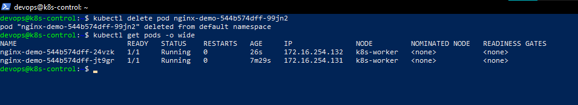 | 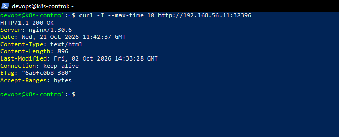 |
| Replacement Pod created after deleting an existing replica | Earlier Deployment revision restored and HTTP connectivity rechecked |

**Additional evidence:** [Four NGINX replicas](screenshots/55-nginx-horizontal-scaling-four-replicas.png) · [Successful rolling update](screenshots/56-nginx-rolling-update-success.png) · [Connectivity after update](screenshots/57-nginx-post-update-connectivity.png) · [Kubernetes system Pods](screenshots/43-kubernetes-system-pods-running.png)

> **Evidence note:** Screenshots document observed results at particular stages. Four healthy Pods demonstrate workload-level replication and Pod recovery, but they do not establish worker-node high availability when all replicas run on one worker.

---

## Engineering Skills — Linked to Implementation

| Engineering skill | How I applied it | Evidence |
| --- | --- | --- |
| **Linux administration** | Configured Ubuntu VMs, network interfaces, addresses and system prerequisites | [Static IP](screenshots/06-control-plane-static-ip.png), [VM networking](screenshots/04-control-plane-hostonly.png) |
| **Kubernetes administration** | Initialised a cluster with kubeadm, joined a worker and checked node readiness | [Nodes Ready](screenshots/49-two-node-kubernetes-cluster-ready.png) |
| **Container runtime** | Prepared containerd for Kubernetes container execution | [containerd configuration](screenshots/16-control-plane-containerd.png) |
| **Kubernetes networking** | Installed Calico and tested ClusterIP/NodePort request paths | [Calico](screenshots/42-calico-cni-installation.png), [ClusterIP test](screenshots/52-nginx-clusterip-service-connectivity.png) |
| **Declarative Kubernetes** | Defined NGINX replicas, resource limits, health probes and rollout strategy in YAML | [Deployment manifest](manifests/deployment.yaml) |
| **Service networking** | Created internal and externally reachable lab Services using Pod selectors | [ClusterIP](manifests/service-clusterip.yaml), [NodePort](manifests/service-nodeport.yaml) |
| **Workload operations** | Performed scaling, Pod deletion, rolling update and rollback | [Scaling](screenshots/55-nginx-horizontal-scaling-four-replicas.png), [Rollout](screenshots/56-nginx-rolling-update-success.png) |
| **Incident investigation** | Troubleshot VirtualBox acceleration, cluster bootstrap and API access | [VT-x](screenshots/37-native-vtx-acceleration-confirmed.png), [RBAC](screenshots/28-kubernetes-rbac-recovery.png) |
| **Technical documentation** | Preserved manifests, architecture, screenshots and a recorded walkthrough | [Architecture](screenshots/59-kubeadm-kubernetes-architecture.png), [Video](https://youtu.be/a9hATioCGcs) |

---

## Technical Environment & Platform Configuration

| Component | Project configuration |
| --- | --- |
| Host operating system | Windows |
| Virtualisation | Oracle VirtualBox |
| Guest operating system | Ubuntu **26.04.1 LTS**, as recorded during the project |
| Kubernetes | **v1.35.9**, recorded project version |
| Cluster bootstrapping | **kubeadm** |
| Control plane | `k8s-control` |
| Worker node | `k8s-worker` |
| Container runtime | **containerd 2.2.2**, recorded project version |
| Container Network Interface | **Calico v3.31.0**, recorded project version |
| VM networking | NAT and host-only adapters |
| Workload | NGINX using `nginx:stable` |
| Deployment replicas | **4** |
| Internal Service | `nginx-service`, ClusterIP port `80` |
| Host access | `nginx-nodeport`, NodePort `32396` |
| Deployment strategy | `RollingUpdate` |
| Rolling-update surge | `maxSurge: 1` |
| Rolling-update unavailability | `maxUnavailable: 0` |
| Readiness/liveness | HTTP `GET /` on port `80` |
| CPU request / limit | `100m` / `500m` |
| Memory request / limit | `64Mi` / `128Mi` |

The Kubernetes workload values are documented in the committed manifests. OS, containerd, Kubernetes and Calico versions reflect the original build documentation; the repository does not contain a full automated rebuild or version-audit system.

---

## Engineering Decisions — Why Build Kubernetes This Way?

### Why kubeadm instead of another managed Kubernetes cluster?

My [AWS EKS project](https://github.com/ismaaeelahmed11/eks-project) demonstrated deploying and operating workloads on an AWS-managed Kubernetes platform.

However, EKS manages the Kubernetes control plane, meaning much of the cluster bootstrapping and control-plane infrastructure is handled by AWS.

For this project, I deliberately used **kubeadm** to understand Kubernetes more directly:

- Preparing Linux nodes for Kubernetes.
- Installing and configuring a container runtime.
- Initialising the control plane.
- Joining worker nodes.
- Installing a Container Network Interface.
- Configuring access to the Kubernetes API.
- Investigating system-level problems independently of a cloud provider.

The goal was to understand what happens **underneath the platform**, not simply repeat the application-deployment portion of EKS.

### Why two Ubuntu virtual machines?

Two VMs enabled me to separate the **control-plane** and **worker** roles and observe how nodes communicate.

This was a practical, resource-conscious environment for studying cluster operations without leaving AWS infrastructure running.

However, two nodes do not establish a highly available cluster. The lab has **one control plane and one worker**, meaning each remains a potential single point of failure.

### Why containerd?

Kubernetes requires a compatible container runtime to execute containers.

I configured **containerd** as the runtime on the Ubuntu infrastructure, giving me direct exposure to runtime dependencies that are largely hidden when using managed container services.

This reinforces the distinction between Kubernetes orchestration and the runtime responsible for executing container workloads.

### Why Calico?

Kubernetes needs a functioning Container Network Interface to enable Pod networking.

I installed **Calico** to provide the Pod networking required for applications to communicate within the cluster.

Working with the CNI helped me understand why a reachable API server alone does not guarantee application networking is ready.

### Why separate ClusterIP and NodePort Services?

I wanted to demonstrate two Kubernetes networking use cases:

**ClusterIP:** Stable internal access from clients within Kubernetes.

**NodePort:** Access to the application through a reachable node IP and an exposed port.

Both Services select the same NGINX Pods, allowing me to verify different network paths independently.

---

## Building the Cluster — From Linux VMs to `Ready`

### Stage 1 — Prepare Ubuntu infrastructure

I created two Ubuntu virtual machines in VirtualBox and configured their networking using NAT and host-only adapters.

The host-only network used fixed node addresses:

- `k8s-control` — `192.168.56.10`
- `k8s-worker` — `192.168.56.11`

I checked the networking configuration and VM prerequisites before proceeding with Kubernetes installation.

**Evidence:** [NAT adapter](screenshots/03-control-plane-nat.png) · [Host-only adapter](screenshots/04-control-plane-hostonly.png) · [Static control-plane IP](screenshots/06-control-plane-static-ip.png)

### Stage 2 — Configure containerd and Kubernetes tools

I installed and configured **containerd** and prepared Kubernetes tools for cluster administration.

This required understanding the relationship between:

- The Ubuntu operating system.
- The container runtime.
- Kubernetes node processes.
- The kubeadm bootstrap process.
- Network connectivity between nodes.

**Evidence:** [containerd configuration](screenshots/16-control-plane-containerd.png) · [Kubernetes tools](screenshots/22-kubernetes-tools-installed.png)

### Stage 3 — Bootstrap the Kubernetes control plane

I used **kubeadm** to initialise the control plane, configured administrative access to Kubernetes and prepared the environment for worker-node registration.

I then joined the worker node to the cluster and checked Kubernetes node status.

**Verified result:** Both `k8s-control` and `k8s-worker` reported `Ready`.

**Evidence:** [Two-node Kubernetes cluster](screenshots/49-two-node-kubernetes-cluster-ready.png)

### Stage 4 — Install Calico CNI

I installed Calico for Kubernetes Pod networking and verified the relevant system components.

This was essential for progressing from a bootstrapped control plane to a working environment capable of scheduling and networking application Pods.

**Evidence:** [Calico installation](screenshots/42-calico-cni-installation.png) · [Kubernetes system Pods](screenshots/43-kubernetes-system-pods-running.png)

### Stage 5 — Validate cluster readiness

I validated the cluster through `kubectl`, inspecting the registered nodes and system workloads.

```bash
kubectl cluster-info
kubectl get nodes -o wide
kubectl get pods -A
```

The successful node and workload checks provided evidence that the cluster was operational before deploying application resources.

### kubeadm versus EKS — What was different?

| Engineering area | Self-managed kubeadm | Amazon EKS |
| --- | --- | --- |
| **Control plane** | I initialised and troubleshot the control plane | AWS manages the control plane |
| **Operating systems** | I prepared Ubuntu VMs and their networking | AWS-managed node groups abstract much of node provisioning |
| **Container runtime** | I configured containerd | Runtime setup is integrated into managed node environments |
| **CNI** | I installed Calico | EKS typically uses AWS-oriented networking integrations |
| **Workload deployment** | I managed Kubernetes Deployments and Services | Kubernetes Deployments and Services remain the user's responsibility |
| **Troubleshooting** | Included hypervisor, Linux, runtime and control-plane issues | Included AWS IAM, EKS access, CSI storage and managed-node operations |

**Implementation boundary:** VM provisioning and kubeadm setup were performed manually. This repository includes application manifests and evidence, **not an automated infrastructure provisioning system**.

---

## Kubernetes Application — Deployment, Services & Health Checks

### NGINX Deployment

I created a declarative Kubernetes Deployment defining the desired NGINX workload.

The committed [`manifests/deployment.yaml`](manifests/deployment.yaml) specifies:

- **4 desired replicas**.
- Container image `nginx:stable`.
- Pod label `app: nginx-demo`.
- Container port `80`.
- HTTP readiness probe.
- HTTP liveness probe.
- CPU and memory requests/limits.
- A controlled `RollingUpdate` strategy.

### Resource requests and limits

| Resource | Request | Limit |
| --- | --- | --- |
| CPU | `100m` | `500m` |
| Memory | `64Mi` | `128Mi` |

**Requests** are used by the Kubernetes scheduler to help determine where workloads can be placed.

**Limits** restrict the resources containers may consume.

These settings also let me observe how workload definitions influence Kubernetes scheduling and node-capacity requirements.

### Readiness and liveness probes

The application exposes the default NGINX root path `/` on port `80`.

The Deployment includes:

- **Readiness probe:** Checks whether the container is ready to receive traffic.
- **Liveness probe:** Checks whether the container should be restarted after failing its configured health check.

Readiness and liveness checks are not interchangeable. One influences traffic eligibility; the other influences container recovery.

### Rolling-update strategy

The committed Deployment specifies:

```yaml
strategy:
  type: RollingUpdate
  rollingUpdate:
    maxSurge: 1
    maxUnavailable: 0
```

This configuration permits one additional Pod during updates while aiming to preserve the desired number of available replicas.

However, successful rollout depends on sufficient cluster resources, scheduling and probe behaviour. The configuration alone does not guarantee zero downtime.

### ClusterIP Service

The internal Service is defined in [`manifests/service-clusterip.yaml`](manifests/service-clusterip.yaml).

| Setting | Value |
| --- | --- |
| Name | `nginx-service` |
| Type | `ClusterIP` |
| Service port | `80` |
| Target port | `80` |
| Selector | `app: nginx-demo` |

This provides a stable internal endpoint for clients within the Kubernetes cluster.

### NodePort Service

The externally reachable lab Service is defined in [`manifests/service-nodeport.yaml`](manifests/service-nodeport.yaml).

| Setting | Value |
| --- | --- |
| Name | `nginx-nodeport` |
| Type | `NodePort` |
| Service port | `80` |
| Target port | `80` |
| NodePort | `32396` |
| Selector | `app: nginx-demo` |

The application was accessible from the Windows host through:

```text
http://192.168.56.11:32396
```

This demonstrated the full path from the Windows browser, through VirtualBox host-only networking and Kubernetes Service routing, to an NGINX Pod.

**Evidence:** [Pod placement](screenshots/51-nginx-workloads-on-worker.png) · [ClusterIP connectivity](screenshots/52-nginx-clusterip-service-connectivity.png) · [NodePort access](screenshots/53-nginx-nodeport-browser-access.png)

---

## Kubernetes Operations — Scaling, Self-Healing & Rollbacks

Bootstrapping a cluster was only the first stage. I also tested **day-to-day Kubernetes workload operations** against the running environment.

| Operation | Action | Verified outcome |
| --- | --- | --- |
| **Horizontal scaling** | Increased NGINX replicas to four | Four running NGINX Pods |
| **Pod self-healing** | Deleted an existing NGINX Pod | Replacement Pod created automatically |
| **Rolling update** | Updated the NGINX Deployment image | Rollout completed |
| **Post-update validation** | Tested NGINX after the rollout | Application remained reachable |
| **Rollback** | Restored the previous Deployment revision | Application connectivity verified after rollback |

### 1. Horizontal scaling — four NGINX replicas

I scaled the NGINX Deployment using Kubernetes commands:

```bash
kubectl scale deployment nginx-demo --replicas=4

kubectl get deployment nginx-demo

kubectl get pods -l app=nginx-demo -o wide
```

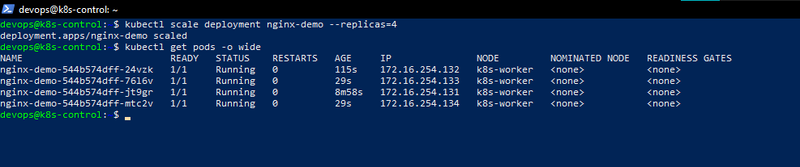

**Observed outcome:** Four NGINX Pods were running on the worker node.

This demonstrates **manual horizontal scaling** at the application Pod level.

It does **not** demonstrate Horizontal Pod Autoscaling (HPA), automatic node scaling or multi-node high availability.

### 2. Pod self-healing — Kubernetes controller reconciliation

I tested Kubernetes self-healing by deleting a running NGINX Pod.

The Deployment/ReplicaSet controller detected that the observed state no longer matched the desired replica count and created a replacement Pod.

```bash
kubectl get pods -l app=nginx-demo

# Delete an existing NGINX Pod during a controlled test
kubectl delete pod <nginx-pod-name>

# Watch Kubernetes create the replacement
kubectl get pods -l app=nginx-demo -w
```


**Observed outcome:** Kubernetes restored the desired number of application replicas.

**Engineering lesson:** Kubernetes controllers continuously reconcile actual state against desired state.

This test validates **Pod-level recovery**, not worker-node failover. If the only worker node becomes unavailable, all four NGINX replicas may become unavailable together.

### 3. Rolling update — controlled application deployment

I performed a rolling update by changing the NGINX application image revision.

I checked Deployment rollout progress and confirmed that the application remained reachable after the update.

```bash
kubectl rollout status deployment/nginx-demo

kubectl rollout history deployment/nginx-demo

kubectl get pods -l app=nginx-demo -o wide
```

**Evidence:** [Rolling update succeeded](screenshots/56-nginx-rolling-update-success.png) · [Connectivity after update](screenshots/57-nginx-post-update-connectivity.png)

The Deployment uses:

```yaml
maxSurge: 1
maxUnavailable: 0
```

This is intended to maintain available replicas during rollout, subject to sufficient cluster capacity and successful readiness checks.

### 4. Rollback — restore an earlier revision

I tested Kubernetes Deployment rollback to restore the preceding workload revision.

```bash
kubectl rollout undo deployment/nginx-demo

kubectl rollout status deployment/nginx-demo

kubectl rollout history deployment/nginx-demo
```

After rollback, I checked that the application was still accessible.


**Verified outcome:** The previous Deployment revision was restored and application connectivity was rechecked.

**Engineering lesson:** A completed rollback command is not sufficient proof of service recovery. The workload state and application request path should be validated afterwards.

### Important distinction — Live state versus Git state

Commands such as `kubectl scale`, `kubectl set image` and `kubectl rollout undo` directly modify the running Kubernetes Deployment.

For persistent, repeatable desired-state management, corresponding manifest changes should be reflected in version control.

This project demonstrates manual workload operations. It does **not** claim a GitOps or CI/CD deployment controller.

That distinction separates this project from my [Amazon EKS project](https://github.com/ismaaeelahmed11/eks-project), which includes Argo CD and GitHub Actions.

---

## Troubleshooting & Root Cause Analysis

An important part of this project was diagnosing problems beyond application YAML.

Because I managed the Ubuntu VMs and Kubernetes bootstrap myself, I had to investigate failures across **VirtualBox, Linux, container runtime prerequisites, Kubernetes API access and workload networking**.

### Incident 1 — VirtualBox CPU and virtualisation problems

**Problem**

During cluster setup, the control-plane VM encountered CPU/performance issues that prevented Kubernetes bootstrap and system components from progressing normally.

**Investigation**

I examined the underlying VirtualBox environment, VM resource allocation and native hardware virtualisation support.

Rather than treating every Kubernetes error as an issue with the application or kubeadm configuration, I investigated whether the host virtualisation environment was functioning correctly.

**Resolution**

I recovered the VM environment with native hardware acceleration available and continued Kubernetes cluster configuration.

**Evidence:** [VT-x acceleration confirmed](screenshots/37-native-vtx-acceleration-confirmed.png) · [Cluster subsequently Ready](screenshots/49-two-node-kubernetes-cluster-ready.png)

**Engineering lesson:** Kubernetes can fail because of infrastructure beneath the control plane. Hypervisor configuration, CPU virtualisation and VM resources must be checked before repeatedly attempting cluster bootstrap.

### Incident 2 — Kubernetes API access and RBAC

**Problem**

Cluster administration encountered API-access and permission-related difficulties during setup and recovery.

**Investigation**

I investigated administrative access to Kubernetes and the relationship between:

- Kubeconfig and the active Kubernetes context.
- Client authentication.
- Kubernetes RBAC authorisation.
- API server availability.
- Administrative credentials and permissions.

**Resolution**

I worked through access recovery and subsequently continued node validation, system checks and application deployment.

**Evidence:** [Kubernetes RBAC/access recovery](screenshots/28-kubernetes-rbac-recovery.png) · [Kubernetes system Pods](screenshots/43-kubernetes-system-pods-running.png)

**Engineering lesson:** A valid kubeconfig does not necessarily grant permission to perform every API operation. Authentication, authorisation, certificates, context and API availability must be investigated independently.

This lab documents access investigation and recovery, not a completed least-privilege RBAC security audit.

### Incident 3 — Understanding Pod redundancy versus node availability

**Observation**

The NGINX Deployment successfully ran four replicas.

However, **all four replicas were scheduled onto the same worker node**.

**Investigation and reasoning**

Multiple Pods provide workload replication, and Kubernetes can replace failed Pods while sufficient cluster resources remain available.

But when the replicas all depend on the same worker, losing that worker can make every replica unavailable.

**Engineering lesson:** Four Pods do not automatically mean a highly available application.

For node-level resilience, I would add additional worker nodes, apply appropriate topology-spreading rules or anti-affinity and test actual node-failure recovery.

Those improvements were **not implemented in this lab**.

### Incident 4 — Verifying ClusterIP and NodePort networking

**Problem being tested**

A healthy Pod and Ready node do not automatically prove that clients can reach the application.

**Investigation**

I verified both Kubernetes networking paths:

1. Internal access through `nginx-service` (ClusterIP).
2. Windows-host access through `nginx-nodeport` and the worker's host-only IP address.

I checked application connectivity through the appropriate Service path rather than relying solely on Pod status.

**Evidence:** [ClusterIP connectivity](screenshots/52-nginx-clusterip-service-connectivity.png) · [NodePort browser access](screenshots/53-nginx-nodeport-browser-access.png)

**Engineering lesson:** Kubernetes networking depends on Service selectors, available Pod endpoints, target ports, node connectivity and the surrounding network environment.

### Key troubleshooting takeaway

Kubernetes issues often originate in different layers:

```text
Host hardware / VirtualBox
          |
          v
Ubuntu Linux and networking
          |
          v
Container runtime (containerd)
          |
          v
kubeadm / Kubernetes control plane
          |
          v
CNI / node networking
          |
          v
Scheduler / Deployments / Pods
          |
          v
Services / application connectivity
```

The main skill demonstrated here is **investigating the correct layer instead of assuming every failure is an application configuration problem**.

---

## Repository Structure

```text
kubeadm-kubernetes-lab/
├── README.md
├── docs/
│   └── Supporting project documentation
├── manifests/
│   ├── deployment.yaml
│   ├── service-clusterip.yaml
│   └── service-nodeport.yaml
└── screenshots/
    └── 19 implementation evidence images
```

### Key repository files

| File | Purpose |
| --- | --- |
| [`manifests/deployment.yaml`](manifests/deployment.yaml) | NGINX replicas, image, health probes, resource limits and rollout strategy |
| [`manifests/service-clusterip.yaml`](manifests/service-clusterip.yaml) | Internal Kubernetes Service networking |
| [`manifests/service-nodeport.yaml`](manifests/service-nodeport.yaml) | Host-access networking through NodePort |
| [`screenshots/`](screenshots/) | Screenshots proving setup, connectivity, scaling, self-healing and troubleshooting |
| [`docs/`](docs/) | Supporting project documentation |

**Reproducibility boundary:** The application manifests are version-controlled and reusable. The VirtualBox machine provisioning and kubeadm bootstrap were performed manually and are not represented as a fully automated build pipeline.

---

## Running the Application on an Existing Kubernetes Cluster

The repository includes Kubernetes manifests for deploying the NGINX application and its Services.

These commands assume a **working Kubernetes cluster already exists**.

They do **not** create VirtualBox VMs, install containerd, initialise kubeadm or configure Calico automatically.

### Prerequisites

- A Kubernetes cluster accessible through `kubectl`.
- Node status reporting `Ready`.
- A functioning container runtime and CNI.
- Permissions to create Kubernetes Deployments and Services.
- Sufficient CPU and memory to schedule the workload.
- A reachable node IP and suitable network/firewall rules for NodePort access.

### 1. Clone the repository

```bash
git clone https://github.com/ismaaeelahmed11/kubeadm-kubernetes-lab.git

cd kubeadm-kubernetes-lab
```

### 2. Verify cluster health

```bash
kubectl config current-context

kubectl cluster-info

kubectl get nodes -o wide

kubectl get pods -A
```

Confirm that the Kubernetes API server is reachable, nodes are Ready and core cluster services are functioning.

### 3. Review Kubernetes manifests

```bash
kubectl apply --dry-run=client -f manifests/

# Optional: compare against current live resources
kubectl diff -f manifests/
```

Review the image reference, resources, replica count and NodePort before deployment.

The manifest uses the mutable `nginx:stable` image tag. For reproducible releases, pin a tested version or digest.

### 4. Deploy NGINX and Services

```bash
kubectl apply -f manifests/

kubectl rollout status deployment/nginx-demo
```

### 5. Verify the application

```bash
kubectl get deployment nginx-demo

kubectl get pods -l app=nginx-demo -o wide

kubectl get services nginx-service nginx-nodeport

kubectl get endpointslices \
  -l kubernetes.io/service-name=nginx-nodeport
```

Check Pod readiness, expected replicas and populated Service endpoints.

### 6. Access the application

In the original VirtualBox environment, NGINX was accessible from Windows through:

```text
http://192.168.56.11:32396
```

For a different Kubernetes environment, determine the reachable node address and inspect the NodePort configuration:

```bash
kubectl get svc nginx-nodeport
```

The original lab address may not work on another machine or cluster.

### 7. Inspect rollouts and rollback history

```bash
kubectl rollout history deployment/nginx-demo

kubectl rollout status deployment/nginx-demo

# Only after a newer revision exists:
kubectl rollout undo deployment/nginx-demo

kubectl rollout status deployment/nginx-demo
```

A Deployment must have an earlier revision for rollback to be meaningful.

---

## Implementation Evidence — 19 Screenshots

The **19 evidence screenshots** are grouped by engineering responsibility. Four key outcomes are featured near the beginning of this README, while the complete evidence inventory appears below.

Each screenshot documents an observed project stage.

<details>
<summary><strong>1. VM Infrastructure & Linux Preparation — 5 Screenshots</strong></summary>

### VirtualBox NAT networking

Outbound connectivity configured for the Ubuntu environment.

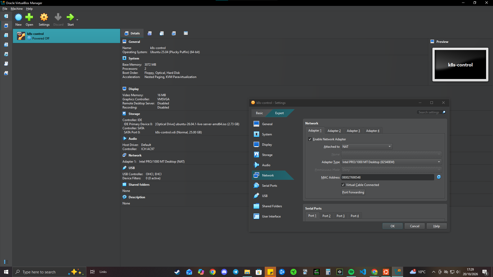

### VirtualBox host-only networking

Local connectivity between the Windows host and Ubuntu VMs.

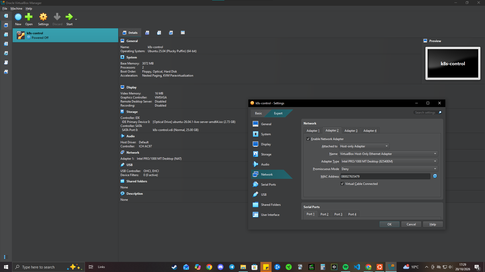

### Static control-plane IP

Predictable IP address assigned for cluster communications.

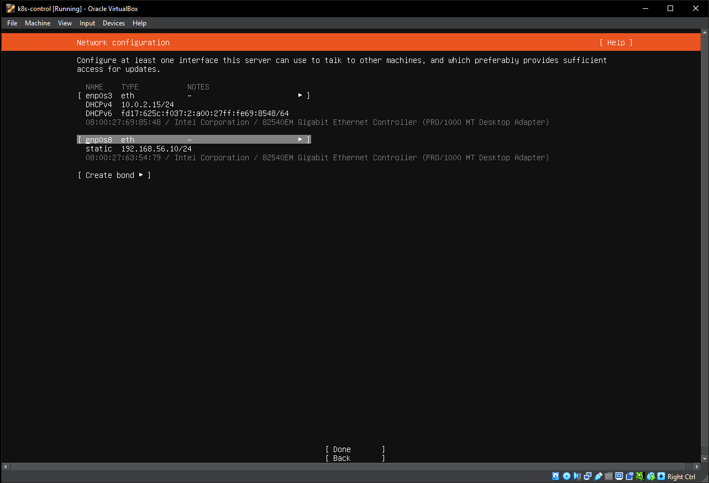

### Containerd configuration

Container runtime configured for Kubernetes.

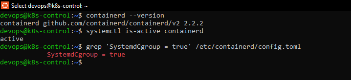

### Kubernetes tooling installed

Kubernetes administration tools installed in the Ubuntu environment.

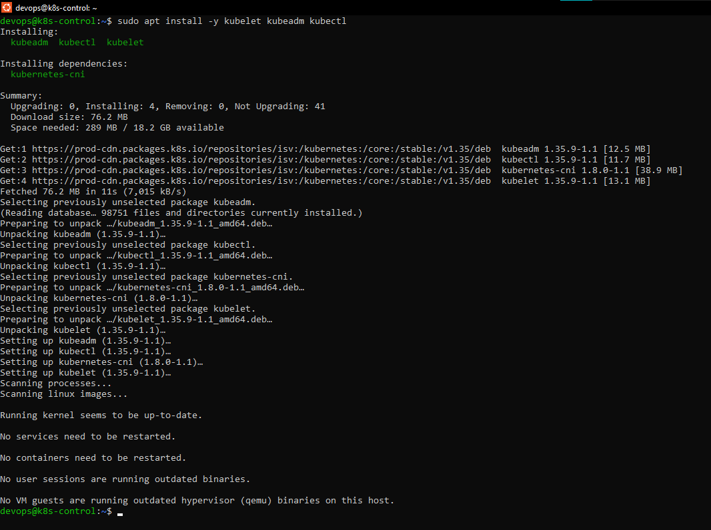

</details>

<details>
<summary><strong>2. Cluster Bootstrap, CNI & Node Readiness — 3 Screenshots</strong></summary>

### Calico networking installation

Calico deployed to provide Pod networking.

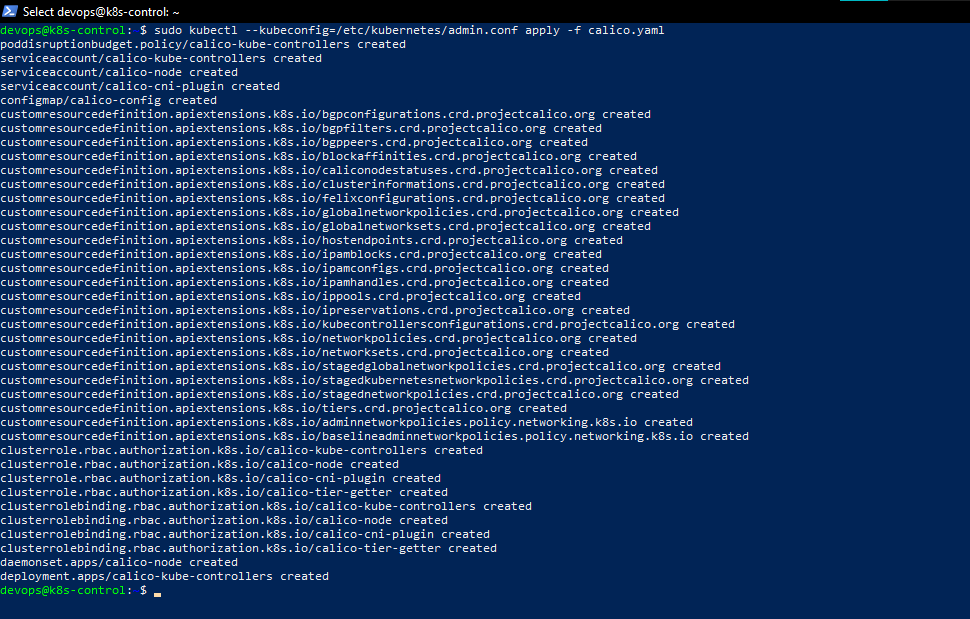

### Kubernetes system Pods running

System components inspected during cluster validation.

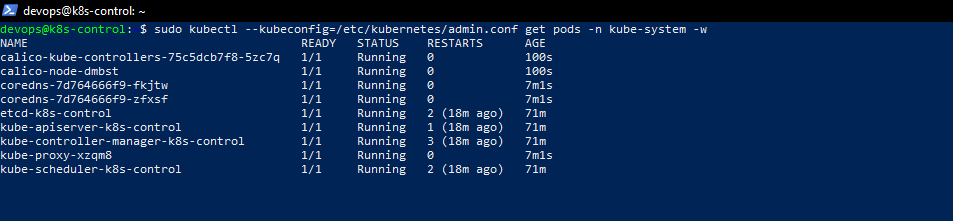

### Two-node Kubernetes cluster Ready

Both the control plane and worker reported Ready status.

[View the two-node cluster screenshot (featured above)](screenshots/49-two-node-kubernetes-cluster-ready.png)

</details>

<details>
<summary><strong>3. NGINX Deployment & Kubernetes Service Networking — 3 Screenshots</strong></summary>

### NGINX workloads scheduled on the worker

Evidence showing application Pods running on the worker node.

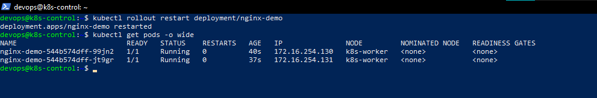

### ClusterIP Service connectivity

Successful application access through the internal Kubernetes Service.

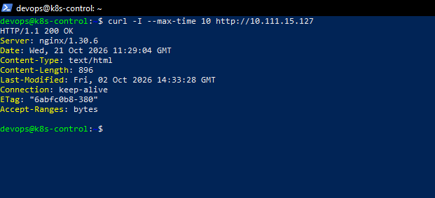

### NodePort access from Windows

NGINX accessed through the worker-node host-only address and NodePort.

[View the NodePort browser screenshot (featured above)](screenshots/53-nginx-nodeport-browser-access.png)

</details>

<details>
<summary><strong>4. Kubernetes Deployment Operations — 5 Screenshots</strong></summary>

### Pod self-healing

Deleted application Pod replaced by the Kubernetes Deployment controller.

[View the Pod self-healing screenshot (featured above)](screenshots/54-kubernetes-self-healing-replacement-pod.png)

### Horizontal scaling to four replicas

Four NGINX replicas running after manually scaling the Deployment.


### Successful rolling update

Deployment update completed successfully.

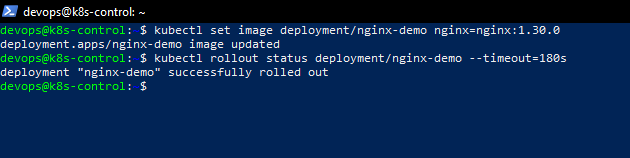

### Application connectivity after update

NGINX remained accessible after the rolling update.

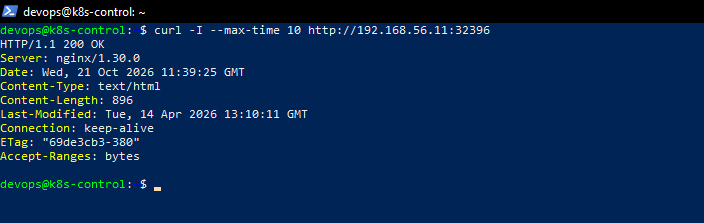

### Application connectivity after rollback

Previous Deployment revision restored and application HTTP access checked.

[View the rollback verification screenshot (featured above)](screenshots/58-nginx-rollback-connectivity.png)

</details>

<details>
<summary><strong>5. Troubleshooting & Recovery — 2 Screenshots</strong></summary>

### Kubernetes administrative access and RBAC

Screenshot evidence from Kubernetes API access/RBAC troubleshooting.

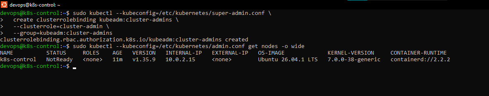

### Native virtualisation acceleration

Hardware virtualisation evidence from investigating CPU and VirtualBox issues.

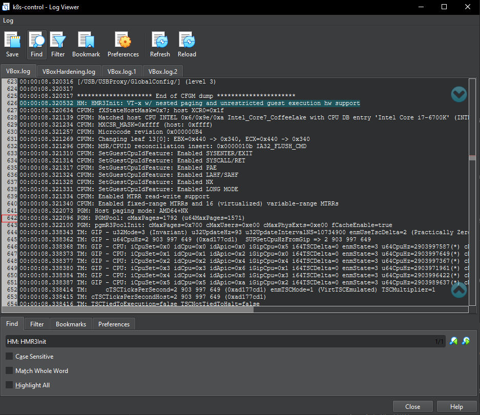

</details>

<details>
<summary><strong>6. Architecture — 1 Screenshot</strong></summary>

### Self-managed Kubernetes architecture

The final architecture diagram showing both Ubuntu VMs, Kubernetes roles, networking and application Service paths.

[View the full draw.io-style architecture diagram (featured above)](screenshots/59-kubeadm-kubernetes-architecture.png)

</details>

---

## Operational Trade-offs & Next Engineering Improvements

| Engineering area | Implemented in this project | Recommended next improvement |
| --- | --- | --- |
| **Control-plane availability** | One kubeadm-managed control plane | Multi-control-plane topology, resilient etcd and tested backups |
| **Worker availability** | One worker hosting four NGINX Pods | Additional workers, topology spread constraints and node-failure testing |
| **Workload scaling** | Manual scaling to four replicas | Metrics Server, HPA and load-driven scaling experiments |
| **Deployment strategy** | Rolling updates and rollback | Pinned image versions, release validation and automated deployment controls |
| **Networking** | Calico CNI, ClusterIP and local NodePort | NetworkPolicy tests, ingress/TLS and network segmentation |
| **Security** | Kubernetes administrative access and RBAC troubleshooting | Least-privilege roles, service accounts and security-policy enforcement |
| **Infrastructure automation** | Manual VirtualBox and kubeadm configuration | Reproducible setup through Ansible, Vagrant or shell automation |
| **Kubernetes lifecycle** | Cluster bootstrap and workload operations | Planned Kubernetes version upgrades of control plane, kubelet and kubectl |
| **Observability** | `kubectl` validation and system-component inspection | Prometheus/Grafana, log aggregation, alerting and operational dashboards |
| **Disaster recovery** | Pod replacement and Deployment rollback | Actual node-loss tests, etcd backup/restore and recovery procedures |

**These are future engineering improvements, not completed achievements.**

In particular, this project does **not** claim a tested kubeadm cluster-version upgrade, high-availability control plane, automatic node failover, HPA, GitOps or end-to-end infrastructure provisioning automation.

Clearly distinguishing between completed implementations and proposed improvements makes the project easier to review and discuss.

---

## Engineering Outcomes & Interview Discussion

This project demonstrates practical experience working across multiple layers of a Kubernetes platform:

**Linux infrastructure → Container runtime → Kubernetes bootstrap → Pod networking → Deployments → Services → Workload operations → Troubleshooting.**

The main accomplishment was not simply getting NGINX running. It was understanding how the supporting infrastructure works, independently configuring it and verifying Kubernetes behaviour through controlled operational tests.

### What I can discuss in a technical interview

**1. kubeadm and cluster bootstrapping**

How I prepared Linux virtual machines, configured containerd, initialised the control plane, installed Calico and joined a worker node.

**2. Kubernetes networking**

How ClusterIP and NodePort differ, how Service selectors connect requests to Pods and why host-to-VM networking matters.

**3. Kubernetes scheduling and replication**

Why four replicas improve workload-level redundancy but do not guarantee availability when all Pods share one worker.

**4. Pod self-healing**

How Deployments and ReplicaSets detect missing Pods and reconcile actual state against the configured replica count.

**5. Rolling updates and rollback**

How rollout strategies, readiness probes, surge capacity and Deployment revisions affect application releases.

**6. Troubleshooting Kubernetes below the application layer**

How VirtualBox, Linux, containerd, Kubernetes administrative access and the network layer can influence cluster and application health.

### How this complements my AWS projects

| Project | Main engineering focus |
| --- | --- |
| **AWS ECS Fargate** | Container delivery, AWS infrastructure, Terraform, Docker, GitHub Actions and HTTPS |
| **Amazon EKS** | Managed Kubernetes, AWS networking, GitOps, monitoring, IAM/OIDC and CSI storage |
| **Self-Managed kubeadm** | Linux administration, cluster bootstrap, container runtime, CNI, Kubernetes workload operations and troubleshooting |

Together, these projects demonstrate experience working with both **managed cloud platforms and self-managed Kubernetes infrastructure**, supported by source code, architectural explanations and captured evidence.

**Project context:** This is independent hands-on portfolio work completed alongside my DevOps engineering development in 2026, after building my Amazon EKS platform. It uses real Linux VMs and Kubernetes components but is **not presented as commercial production administration experience**.

### Related Engineering Projects

- **[Amazon EKS — Terraform, Kubernetes, GitOps, CI/CD & Monitoring](https://github.com/ismaaeelahmed11/eks-project)** — AWS-managed Kubernetes platform with Argo CD, NGINX Ingress, cert-manager, ExternalDNS and Prometheus/Grafana. [Watch walkthrough](https://youtu.be/RDmnaTi2auE).
- **[AWS ECS Fargate — Production-Grade Terraform, Docker & CI/CD](https://github.com/ismaaeelahmed11/devops-learning/tree/main/ecs-project)** — Go application deployed to ECS Fargate with modular Terraform, GitHub Actions, ALB, HTTPS and CloudWatch. [Watch walkthrough](https://youtu.be/qpIZlJkWmos).
- **[DevOps Engineering Portfolio](https://github.com/ismaaeelahmed11/devops-learning)** — Linux, Bash, Git, Networking, Docker, Terraform, AWS, CI/CD and Kubernetes engineering projects.

---

**Ismaaeel Ahmed · DevOps & Cloud Engineering**  
[GitHub Portfolio](https://github.com/ismaaeelahmed11) · [LinkedIn](https://www.linkedin.com/in/ismaaeelahmed) · [Email](mailto:ismaaeelahmed11@gmail.com) · [Project Walkthrough (2:00)](https://youtu.be/a9hATioCGcs)
